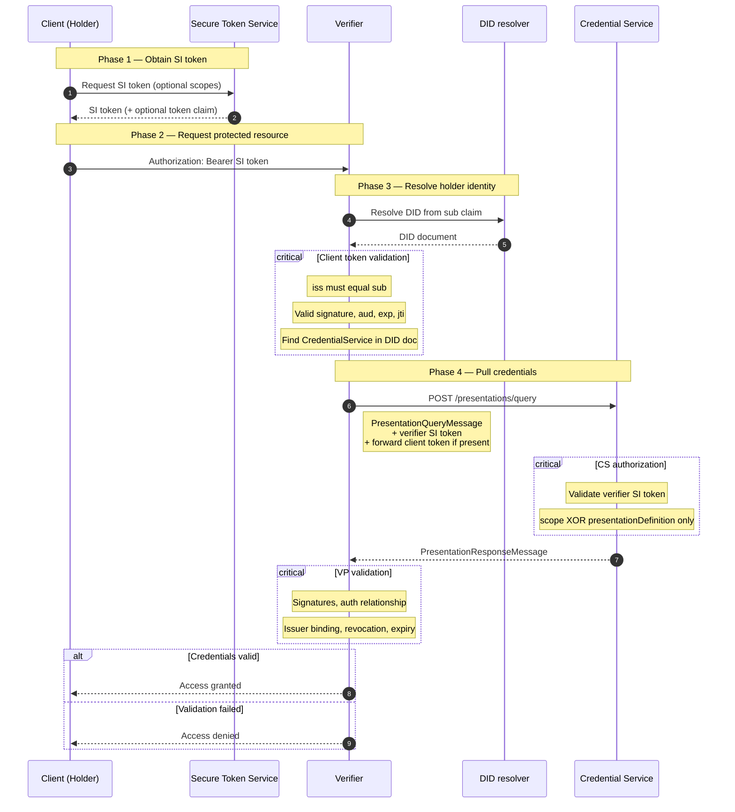
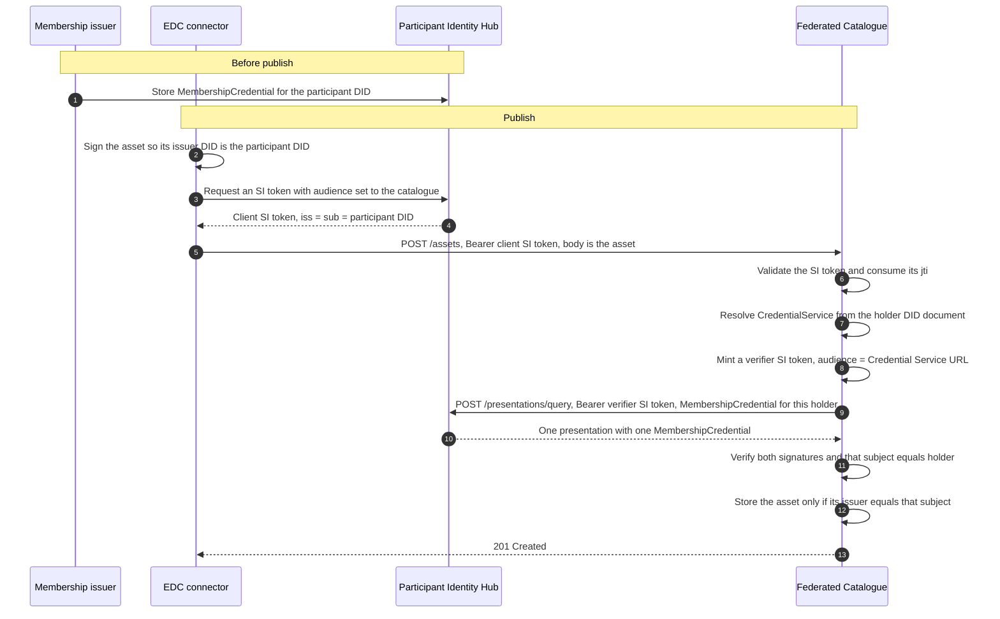

# EDC to Cataglogue POST Asset

## DCP Flow General

A client wants access to something the verifier protects. The verifier does not trust the client’s word alone; it fetches Verifiable Presentations from the holder’s Credential Service.

**Presentation query conditions** ([spec](https://eclipse-dataspace-dcp.github.io/decentralized-claims-protocol/v1.0.1/#presentation-query-message)):

- `PresentationQueryMessage` must contain **`scope`** or **`presentationDefinition`**, not both
- **`scope`**: normative aliases include `org.eclipse.dspace.dcp.vc.type:…` and `org.eclipse.dspace.dcp.vc.id:…`
- If the query used **`presentationDefinition`**, the response **must** include **`presentationSubmission`**
- Credential Service may return fewer presentations than requested if the holder is not entitled to some scopes (still HTTP 2xx)

## DCP Catalogue Flow

Identity Hub does not sign the asset. It stores the `MembershipCredential` (issued earlier by the trusted membership issuer) and its STS issues the client SI token. The `POST /assets` body is the asset. A `PresentationResponseMessage` as that body is rejected. The catalogue only allows self-publishing: the asset issuer DID must equal the membership subject, which must equal the SI holder.

There are two SI tokens. The connector sends one whose audience is the catalogue (`Authorization: Bearer` on `POST /assets`, `iss` = `sub` = participant DID, `capabilityInvocation` key, fresh `jti`). The catalogue then mints its own verifier SI token, audience set to the holder's Credential Service, and uses that on the outbound query. The client `jti` is consumed in PostgreSQL before that call.

The pull is a scoped presentation query, not a fetch of the latest credentials. The catalogue resolves the `CredentialService` endpoint from the holder DID document, then `POST`s a `PresentationQueryMessage` to `{credentialService}/presentations/query`. It accepts exactly one signed presentation containing exactly one `MembershipCredential` from the configured issuer, bound to that holder, and verifies both signatures before storing the asset.

## POST Asset Credential Flow

**Christian Weiers**

## EDC Extension

**Ernst Schrewe**

## Auth

### Policies

- Access policy for query
- Contract policy
- Asset Post policy (DCP auth)

